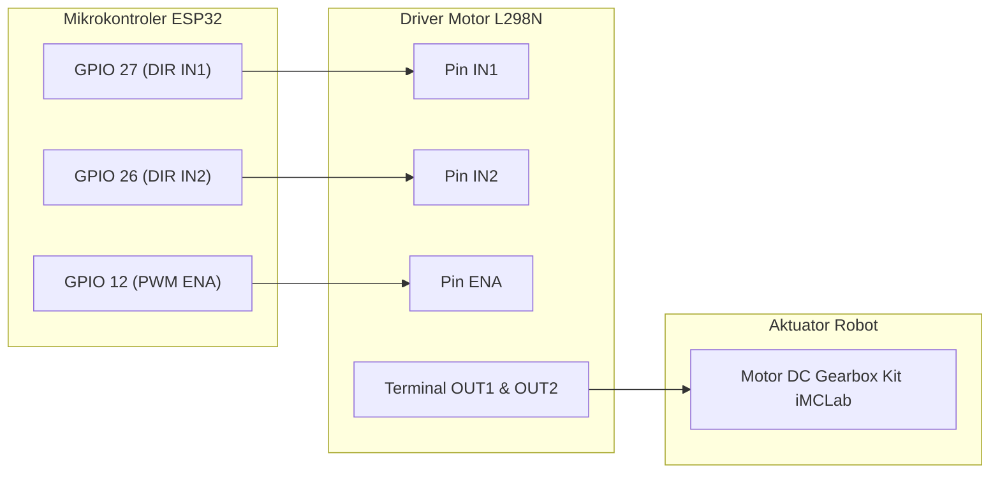
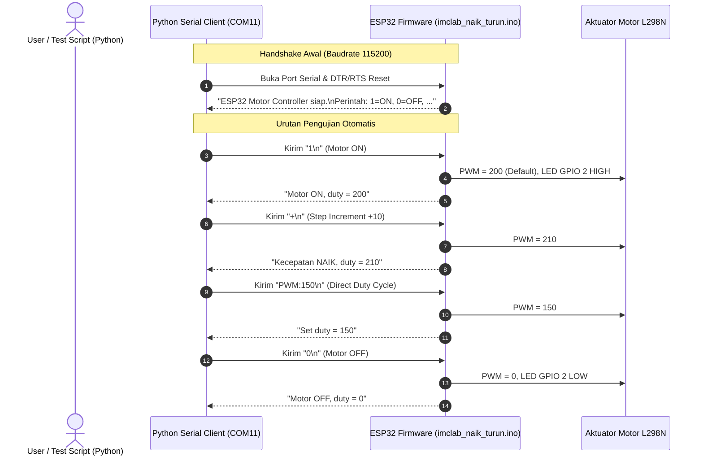
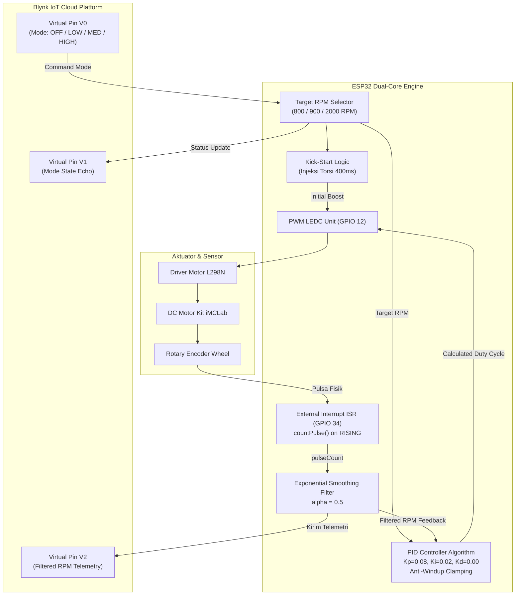
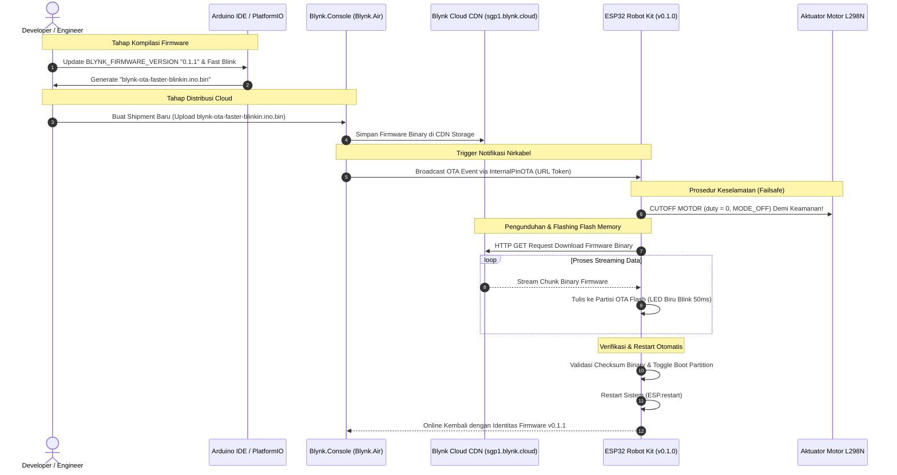

# LAPORAN RISET PRAKTIKUM ROBOTIKA (UJIAN TENGAH SEMESTER)
## Eksperimen Kendali Robot Bergerak Kit iMCLab: Open-Loop PWM, Python Serial UART, Closed-Loop PID IoT Blynk, dan Over-The-Air (OTA) Firmware Update

---

### IDENTIFIKASI AKADEMIK & PROYEK
* **Mata Kuliah:** Robotika (UTS Praktikum)
* **Target Sistem:** Embedded Robot Kit iMCLab berbasis Espressif ESP32 NodeMCU-32S
* **Aktuator & Driver:** DC Gearmotor + Dual H-Bridge L298N
* **Sensor Feedback:** Single-channel Optical Rotary Encoder (GPIO 34)
* **Konektivitas & IoT:** USB-to-UART CP210x Bridge, Wi-Fi 2.4 GHz, Blynk IoT Cloud Platform
* **Repositori Dokumen & Kode:** `D:\Github\UTS-UAS-Robotics\UTS`

---

## DAFTAR ISI
1. [Ringkasan Eksekutif](#1-ringkasan-eksekutif)
2. [Modul 1: Pemrograman Basic Robotika Kit iMCLab (Open-Loop PWM)](#2-modul-1-pemrograman-basic-robotika-kit-imclab-open-loop-pwm)
3. [Modul 2: Pemrograman Robotika Kit iMCLab Menggunakan Python (Serial UART)](#3-modul-2-pemrograman-robotika-kit-imclab-menggunakan-python-serial-uart)
4. [Modul 3: Pemrograman iMCLab Berbasis Blynk (Closed-Loop PID Control via IoT)](#4-modul-3-pemrograman-imclab-berbasis-blynk-closed-loop-pid-control-via-iot)
5. [Modul 4: Pemrograman OTA Berbasis Blynk (Wireless Firmware Deployment)](#5-modul-4-pemrograman-ota-berbasis-blynk-wireless-firmware-deployment)
6. [Analisis Integratif & Matriks Komparasi Modul](#6-analisis-integratif--matriks-komparasi-modul)
7. [Kesimpulan & Proyeksi Riset Lanjutan (Persiapan UAS)](#7-kesimpulan--proyeksi-riset-lanjutan-persiapan-uas)

---

## 1. RINGKASAN EKSEKUTIF

Riset praktikum Ujian Tengah Semester (UTS) Robotika ini berfokus pada integrasi bertingkat sistem kontrol motor bergerak (*mobile robot*) menggunakan platform **Kit iMCLab** bertenaga mikrokontroler **ESP32**. Riset diorganisasikan dalam empat modul eksperimen progresif:

1. **Modul 1 (Tingkat Dasar):** Pengujian karakteristik switching aktuator motor DC dan driver L298N dengan teknik Pulse Width Modulation (PWM) hardware ESP32 secara *open-loop*.
2. **Modul 2 (Tingkat Komunikasi Serial):** Perancangan protokol kontrol dua arah (*bidirectional UART*) berbasis teks ASCII antara komputer host (Python/Jupyter Notebook) dan mikrokontroler, dilengkapi algoritma heuristik *auto-detection* port serial USB.
3. **Modul 3 (Tingkat Otomasi Tertutup & IoT):** Implementasi kontrol kecepatan lingkar tertutup (*closed-loop*) dengan algoritma kendali **Proportional-Integral-Derivative (PID)**, umpan balik sensor rotary encoder interupsi perangkat keras, penapis derau *exponential smoothing*, serta telemetri *real-time* via Blynk IoT Cloud.
4. **Modul 4 (Tingkat Pemeliharaan Jarak Jauh):** Validasi arsitektur pembaruan firmware nirkabel **Over-The-Air (OTA)** melalui Blynk.Air CDN, dilengkapi pengujian mekanisme *failsafe motor shutdown* dan diferensiasi frekuensi indikator LED visual.

Keempat modul ini merepresentasikan fondasi teleoperasi dan otomasi robotika modern dari lapisan antarmuka fisik hingga lapisan kendali nirkabel jarak jauh berbasis awan (*cloud*).

---

## 2. MODUL 1: PEMROGRAMAN BASIC ROBOTIKA KIT iMCLab (OPEN-LOOP PWM)

### 2.1 Tujuan Eksperimen
* Mengonfigurasi modul driver motor H-Bridge L298N bersama ESP32.
* Mengimplementasikan periferal LED Control (LEDC) ESP32 untuk membangkitkan sinyal PWM berfrekuensi 5 kHz dengan resolusi 8-bit.
* Menganalisis respon kecepatan motor DC tanpa umpan balik (*open-loop system*).

### 2.2 Konfigurasi Perangkat Keras & Pengkabelan
Sistem menggunakan modul L298N sebagai perantara tegangan daya motor dan logika ESP32 (3.3V Logic):

| Komponen / Sinyal | Pin Driver L298N | Pin Mikrokontroler ESP32 | Fungsi Sinyal |
| :--- | :--- | :--- | :--- |
| **Logic IN1** | IN1 | **GPIO 27** | Penentu arah polaritas motor (Fase Maju: HIGH) |
| **Logic IN2** | IN2 | **GPIO 26** | Penentu polaritas referensi motor (Fase Maju: LOW) |
| **Enable A (PWM)**| ENA | **GPIO 12** | Input modulasi lebar pulsa (Duty Cycle Kecepatan) |
| **Ground Common** | GND | **GND** | Referensi ground bersama (*common ground*) |



### 2.3 Analisis Kode Program & Implementasi
Kode sumber eksperimen berada pada file [`nyala.ino`](file:///D:/Github/UTS-UAS-Robotics/UTS/Code%20basic%20robotika%20dengan%20Kit%20iMCLab/nyala.ino):

```cpp
#include <Arduino.h>

// --- KONFIGURASI PIN & PWM ---
int motorPin1 = 27;     // Pin IN1 pada driver L298N
int motorPin2 = 26;     // Pin IN2 pada driver L298N
int enablePin = 12;     // Pin ENA (Enable A) pada driver, untuk sinyal PWM

// Properti PWM ESP32 LEDC
const int PWM_CHANNEL = 0;    // Channel PWM (0-15)
const int PWM_FREQ = 5000;    // Frekuensi 5000 Hz (5 kHz)
const int PWM_RESOLUTION = 8; // Resolusi 8-bit (0-255)

int motorSpeed = 200; // Duty cycle target (~78.4%)

void setup() {
  pinMode(motorPin1, OUTPUT);
  pinMode(motorPin2, OUTPUT);
  pinMode(enablePin, OUTPUT);

  // Konfigurasi timer hardware PWM dan attach pin
  ledcSetup(PWM_CHANNEL, PWM_FREQ, PWM_RESOLUTION);
  ledcAttachPin(enablePin, PWM_CHANNEL);

  // Atur arah putaran maju (Forward)
  digitalWrite(motorPin1, HIGH);
  digitalWrite(motorPin2, LOW);

  // Terapkan duty cycle PWM
  ledcWrite(PWM_CHANNEL, motorSpeed);
}

void loop() {
  // Motor berjalan statis secara open-loop
}
```

### 2.4 Analisis Teknis & Pembahasan
1. **Pembangkitan PWM LEDC ESP32:**
   ESP32 tidak menggunakan fungsi `analogWrite()` konvensional melainkan periferal LEDC (*LED PWM Controller*) yang memanfaatkan timer perangkat keras dedicated. Dengan resolusi 8-bit, nilai duty cycle berkisar antara $0$ (0% tegangan efektif) hingga $255$ (100% tegangan suplai motor).
   $$\text{Tegangan Efektif} \approx V_{in} \times \left( \frac{\text{Duty Cycle}}{255} \right) = 12\text{V} \times \frac{200}{255} \approx 9.41\text{V}$$
2. **Pemilihan Frekuensi 5 kHz:**
   Frekuensi 5000 Hz dipilih untuk mereduksi dengung harmonik audiosonik (*acoustic noise*) pada lilitan motor yang kerap terjadi jika frekuensi diatur rendah (< 1 kHz), sekaligus menjaga efisiensi perpindahan panas pada transistor BJT modul L298N agar tidak mengalami disipasi daya berlebih (*switching losses*).
3. **Keterbatasan Sistem Open-Loop:**
   Pada sistem ini tidak ada umpan balik kecepatan riil (RPM). Ketika beban mekanis bertambah (misalnya gesekan lantai atau tanjakan), putaran poros motor akan melambat secara signifikan tanpa adanya kompensasi otomatis dari sistem kontrol.

---

## 3. MODUL 2: PEMROGRAMAN ROBOTIKA KIT iMCLab MENGGUNAKAN PYTHON (SERIAL UART)

### 3.1 Tujuan Eksperimen
* Mengembangkan komunikasi serial UART asinkron dua arah antara PC Host dan ESP32 pada kecepatan tinggi (115200 baud).
* Merancang parser perintah teks berbasis karakter ASCII di sisi mikrokontroler.
* Mengembangkan modul Python berkemampuan *auto-detection* port COM berdasarkan pengenalan *Hardware ID* / VID:PID chip USB bridge (Silicon Labs CP210x).

### 3.2 Diagram Alur & Protokol Komunikasi



### 3.3 Struktur Protokol Komunikasi ASCII
Protokol serial dirancang ringkas dengan pembatas baris baru (*delimiter* `\n` atau `\r`):

| Perintah Serial | Parameter | Respon Firmware ESP32 | Aksi Sistem |
| :--- | :--- | :--- | :--- |
| `'1'` | - | `Motor ON, duty = [val]` | Motor berputar pada duty cycle terakhir / 200; LED Biru menyala |
| `'0'` | - | `Motor OFF, duty = 0` | Motor dihentikan (duty = 0); LED Biru padam |
| `'+'` | - | `Kecepatan NAIK, duty = [val]` | Menaikkan duty cycle sebesar $+10$ (batas maksimal 255) |
| `'-'` | - | `Kecepatan TURUN, duty = [val]` | Menurunkan duty cycle sebesar $-10$ (batas minimal 0) |
| `'PWM:<val>'`| $0 \le \text{val} \le 255$ | `Set duty = [val]` | Mengubah duty cycle langsung ke nilai target numerik |

### 3.4 Analisis Kode Firmware ESP32
Potongan kode logika parsing dari [`imclab_naik_turun.ino`](file:///D:/Github/UTS-UAS-Robotics/UTS/Code%20robotika%20Kit%20iMCLab%20menggunakan%20Python/imclab_naik_turun.ino):

```cpp
void loop() {
  while (Serial.available() > 0) {
    char c = Serial.read();
    if (c == '\n' || c == '\r') {
      inputString.trim();
      if (inputString.startsWith("PWM:")) {
        int val = inputString.substring(4).toInt();
        setDuty(val);
      } else if (inputString.length() > 0) {
        char cmd = inputString.charAt(0);
        if (cmd == '1')      MotorOn();
        else if (cmd == '0') MotorOff();
        else if (cmd == '+') naikkanKecepatan();
        else if (cmd == '-') turunkanKecepatan();
        else {
          Serial.print("Perintah tidak dikenal: ");
          Serial.println(inputString);
        }
      }
      inputString = "";
    } else {
      inputString += c;
    }
  }
}
```

### 3.5 Analisis Script Client Python & Hasil Pengujian
Sisi kontrol diimplementasikan pada file notebook [`Tes_IMCLab_naik_turun.ipynb`](file:///D:/Github/UTS-UAS-Robotics/UTS/Code%20robotika%20Kit%20iMCLab%20menggunakan%20Python/Tes_IMCLab_naik_turun.ipynb). Fitur kunci pada skrip ini adalah fungsi **heuristik pencocokan port USB serial**:

```python
ESP32_VID_PID = {
    (0x10C4, 0xEA60), # Silicon Labs CP210x (ESP32 NodeMCU)
    (0x1A86, 0x7523), # CH340 USB-to-Serial
    (0x0403, 0x6001), # FTDI FT232R
}

def deteksi_port_esp32(verbose=True):
    ports = serial.tools.list_ports.comports()
    kandidat = []
    for p in ports:
        teks = f"{p.description} {p.manufacturer} {p.hwid}".lower()
        skor = 0
        if (p.vid, p.pid) in ESP32_VID_PID:
            skor += 100
        for kw in ["cp210", "ch340", "silicon labs", "esp32"]:
            if kw in teks:
                skor += 50
                break
        if "bluetooth" in teks:
            skor -= 200
        if skor > 0:
            kandidat.append((skor, p))
    kandidat.sort(key=lambda x: x[0], reverse=True)
    return kandidat[0][1].device
```

#### Hasil Eksekusi Riil Terrekam pada Notebook:
```text
==================================================
Port serial yang tersedia:
  - COM11 : Silicon Labs CP210x USB to UART Bridge (COM11) [VID:PID=10C4:EA60]
  - COM7  : Standard Serial over Bluetooth link (COM7)
  - COM6  : Standard Serial over Bluetooth link (COM6)
==================================================
Kandidat port ESP32 (skor tertinggi = paling mungkin):
  [ 150] COM11 : Silicon Labs CP210x USB to UART Bridge (COM11)

>> Port ESP32 terpilih: COM11
Terhubung ke ESP32 di COM11 @ 115200 baud

--- Mulai urutan kontrol motor ---
>> Motor ON
ESP32: ESP32 Motor Controller siap.
ESP32: Perintah: 1=ON, 0=OFF, +=naik, -=turun, PWM:xxx=set
ESP32: Motor ON, duty = 200
>> Kecepatan +10 -> ESP32: Kecepatan NAIK, duty = 210
>> Kecepatan +10 -> ESP32: Kecepatan NAIK, duty = 220
>> Kecepatan +10 -> ESP32: Kecepatan NAIK, duty = 230
>> Kecepatan -10 -> ESP32: Kecepatan TURUN, duty = 220
>> Kecepatan -10 -> ESP32: Kecepatan TURUN, duty = 210
>> Set PWM = 150 -> ESP32: Set duty = 150
>> Motor OFF     -> ESP32: Motor OFF, duty = 0
--- Urutan kontrol selesai ---
```

Pengujian ini membuktikan kestabilan antarmuka serial berkecepatan 115200 baud tanpa terjadinya *buffer overflow* atau kehilangan karakter perintah (*packet drop*).

---

## 4. MODUL 3: PEMROGRAMAN iMCLab BERBASIS BLYNK (CLOSED-LOOP PID RPM CONTROL VIA IoT)

### 4.1 Tujuan Eksperimen
* Mengimplementasikan pembacaan putaran roda menggunakan sensor rotary encoder berbasis interupsi perangkat keras (*hardware ISR*).
* Merancang kendali kecepatan lingkar tertutup (*closed-loop PID controller*) untuk menjaga stabilitas putaran RPM motor saat diberi variasi setpoint.
* Mengintegrasikan telemetri kecepatan riil dan kendali mode kecepatan secara nirkabel melalui platform IoT Blynk Cloud.

### 4.2 Arsitektur Sistem Closed-Loop PID & Blynk IoT



### 4.3 Pemetaan Virtual Pin Blynk
Pengkabelan virtual data stream pada aplikasi Blynk IoT dikonfigurasikan sebagai berikut:

| Virtual Pin | Tipe Data | Arah Aliran Data | Deskripsi Operasional |
| :--- | :--- | :--- | :--- |
| **V0** | Integer (0 - 3) | Blynk App $\rightarrow$ ESP32 | Seleksi mode kecepatan: 0=OFF, 1=LOW, 2=MED, 3=HIGH |
| **V1** | Integer (0 - 3) | ESP32 $\rightarrow$ Blynk App | Konfirmasi status operasional mode aktif |
| **V2** | Float (RPM) | ESP32 $\rightarrow$ Blynk App | Data telemetri kecepatan putaran aktual terfilter |
| **V3** | URL / Image | Blynk App $\rightarrow$ Widget | Sinkronisasi antarmuka aset grafis Quickstart |

### 4.4 Analisis Kode Algoritma & Komponen Matematis
Kode sumber eksperimen dianalisis dari file [`initialcode.ino`](file:///D:/Github/UTS-UAS-Robotics/UTS/Code%20iMCLab%20Berbasis%20Blynk/initialcode/initialcode.ino):

#### 1. Pembacaan Sensor Encoder Interupsi Cepat:
```cpp
const int sensorPin = 34; // Pin Input Interrupt (Pull-Up)
volatile uint32_t pulseCount = 0;

void IRAM_ATTR countPulse() {
  pulseCount++; // Dijalankan pada RAM internal untuk latensi minimal
}
```
Pin GPIO 34 dikonfigurasi sebagai input interrupt pada fase naiknya pulsa (`RISING`). Penggunaan atribut `IRAM_ATTR` menjamin rutin penanganan interupsi (ISR) dieksekusi langsung dari RAM internal ESP32, mencegah latensi yang dapat mengakibatkan pulsa terlewat saat motor berputar dengan kecepatan tinggi (> 2000 RPM).

#### 2. Perhitungan RPM & Low-Pass Filter (Exponential Smoothing):
Setiap interval $T = 2000\text{ ms}$, pulsa dihitung secara atomik:
$$\text{Revolutions} = \frac{\text{pulseCount}}{\text{pulsesPerRev}}$$
$$\text{RPM}_{\text{raw}} = \text{Revolutions} \times \left( \frac{60000}{\Delta t_{\text{ms}}} \right)$$
Untuk mereduksi fluktuasi derau akibat ketidaksempurnaan celah roda encoder, sinyal difilter menggunakan *First-Order Exponential Smoothing Filter* dengan faktor penghalusan $\alpha = 0.5$:
$$\text{RPM}_{\text{filt}}(k) = \alpha \cdot \text{RPM}_{\text{raw}}(k) + (1 - \alpha) \cdot \text{RPM}_{\text{filt}}(k-1)$$

```cpp
void processRpmAndPid() {
  noInterrupts();
  uint32_t pulses = pulseCount;
  pulseCount = 0;
  interrupts();

  float revs = (float)pulses / (float)pulsesPerRev;
  float rpm = revs * (60000.0f / (float)rpmIntervalMs);
  rpmFiltered = (rpmAlpha * rpm) + ((1.0f - rpmAlpha) * rpmFiltered);
  Blynk.virtualWrite(V2, rpmFiltered);
  // ... komputasi PID ...
}
```

#### 3. Logika Kick-Start Injeksi Torsi:
Motor DC sering kali mengalami kegagalan putar pada kecepatan rendah akibat gesekan statis (*stiction* pada gearbox Kit iMCLab). Untuk mengatasi fenomena ini, fungsi `setMode()` menginjeksikan duty cycle tinggi (200-255) selama 400 ms pertama sebelum kendali PID murni mengambil alih secara mulus:
```cpp
void setMode(SpeedMode newMode, float newTarget, int kickDuty) {
  mode = newMode;
  targetRPM = newTarget;
  integral = 0; 
  lastError = 0;
  digitalWrite(motor1Pin1, LOW);
  digitalWrite(motor1Pin2, HIGH);

  ledcWrite(pwmChannel, kickDuty);
  kickStartEndTime = millis() + 400; // Injeksi torsi selama 400ms
  isKickStarting = true;
}
```

#### 4. Algoritma Kendali PID & Anti-Windup Clamping:
Fungsi `computePidDuty()` menghitung galat target dan respon PWM:
```cpp
int computePidDuty(float target, float actual, float dtSec) {
  float error = target - actual;
  integral += error * dtSec;
  
  // Anti-windup clamping
  if (integral > integralMax) integral = integralMax;
  if (integral < integralMin) integral = integralMin;
  
  float derivative = (error - lastError) / dtSec;
  lastError = error;

  float output = Kp * error + Ki * integral + Kd * derivative;
  const int minDuty = 70; // Batas deadband minimum motor
  int dutyOut = constrain((int)output, 0, 255);
  if (dutyOut > 0 && dutyOut < minDuty) dutyOut = minDuty;
  return dutyOut;
}
```
Konstanta kendali ditetapkan pada $K_p = 0.08$, $K_i = 0.02$, dan $K_d = 0.00$ (Kendali PI). Nilai $K_i$ bertugas mengeliminasi *steady-state error*, sementara mekanisme pembatasan (*clamping*) integral pada interval $[-5000, 5000]$ secara efektif mencegah terjadinya fenomena *integrator windup* saat motor mengalami transisi beban ekstrim.

---

## 5. MODUL 4: PEMROGRAMAN OTA BERBASIS BLYNK (WIRELESS FIRMWARE DEPLOYMENT)

### 5.1 Tujuan Eksperimen
* Mengonfigurasi modul pembaruan firmware nirkabel Over-The-Air (OTA) melalui infrastruktur **Blynk.Air**.
* Menganalisis alur eksekusi, protokol keamanan *failsafe*, dan partisi flash ESP32 saat proses penulisan firmware baru.
* Memverifikasi keberhasilan pembaruan dari firmware v0.1.0 ke v0.1.1 melalui telemetri cloud, Serial Monitor, dan indikator visual frekuensi kedip LED.

### 5.2 Arsitektur Alur Kerja Blynk.Air OTA Deployment



### 5.3 Analisis Komparasi Perubahan Kode (Diff Analysis)
Eksperimen membandingkan firmware versi awal v0.1.0 ([`Code awal/initialcode.ino`](file:///D:/Github/UTS-UAS-Robotics/UTS/Code%20OTA%20Berbasis%20Blynk/Code%20awal/initialcode.ino)) dengan firmware versi baru v0.1.1 ([`Code baru/new code.ino`](file:///D:/Github/UTS-UAS-Robotics/UTS/Code%20OTA%20Berbasis%20Blynk/Code%20baru/new%20code.ino)):

```diff
  #define BLYNK_TEMPLATE_ID           "TMPL6ENvNREcS"
  #define BLYNK_TEMPLATE_NAME         "Quickstart Template"
- #define BLYNK_FIRMWARE_VERSION      "0.1.0"
+ #define BLYNK_FIRMWARE_VERSION      "0.1.1"
  #define BLYNK_AUTH_TOKEN            "g7MSTm0G93EXFgLrKdSK_pPrdpRNBnbS"

+ // Interval Kedip (Dipercepat untuk v0.1.1)
+ const unsigned long blueLedIntervalFast = 150; // Kedip cepat saat terkoneksi Blynk (sebelumnya 500ms)
+ const unsigned long redLedIntervalFast  = 80;  // Kedip cepat saat motor menyala (sebelumnya 200ms)

  // ... Di dalam loop() ...
  // --- LED Biru: Berkedip Terus-Menerus Ketika WiFi/Blynk Tersambung ---
  if (Blynk.connected()) {
-   if (now - lastBlueLedToggle >= 500) { // Berkedip tiap 500ms
+   if (now - lastBlueLedToggle >= blueLedIntervalFast) { // Berkedip cepat tiap 150ms
        blueLedState = !blueLedState;
        digitalWrite(ledBluePin, blueLedState);
        lastBlueLedToggle = now;
    }
  }

  // --- LED Merah: Berkedip Ketika Motor Bergerak (LOW / MEDIUM / HIGH) ---
  if (mode != MODE_OFF) {
-   if (now - lastRedLedToggle >= 200) { // Berkedip tiap 200ms
+   if (now - lastRedLedToggle >= redLedIntervalFast) { // Berkedip cepat tiap 80ms
        redLedState = !redLedState;
        digitalWrite(ledRedPin, redLedState);
        lastRedLedToggle = now;
    }
  }
```

### 5.4 Analisis Mekanisme Failsafe Keamanan Robotika
Saat mikrokontroler ESP32 melakukan flashing memori flash internal, siklus eksekusi loop utama akan terhenti. Jika motor tetap dibiarkan aktif saat proses transfer data OTA, robot berpotensi mengalami *runaway behavior* (berjalan tanpa kendali dan menabrak rintangan fisik).

Oleh karena itu, fungsi callback `BLYNK_WRITE(InternalPinOTA)` mengimplementasikan protokol penghentian darurat:
```cpp
BLYNK_WRITE(InternalPinOTA) {
  String overTheAirURL = param.asString();
  
  // PROTOKOL KEAMANAN: Hentikan seketika aktuator mekanis
  mode = MODE_OFF;
  digitalWrite(motor1Pin1, LOW);
  digitalWrite(motor1Pin2, LOW);
  digitalWrite(ledRedPin, LOW);
  ledcWrite(pwmChannel, 0);

  // Indikator visual progres unduhan cepat (50 ms)
  httpUpdate.onProgress([](int cur, int total) {
    static unsigned long lastOtaBlink = 0;
    if (millis() - lastOtaBlink >= 50) { 
      digitalWrite(ledBluePin, !digitalRead(ledBluePin));
      lastOtaBlink = millis();
    }
  });

  WiFiClient client;
  t_httpUpdate_return ret = httpUpdate.update(client, overTheAirURL);
  // ... Penanganan status HTTP_UPDATE_OK / FAILED ...
}
```

---

### 5.5 Bukti Eksperimen, Gambar, dan Analisis Data OTA

Pada eksperimen Modul 4, pengujian deployment firmware dilakukan secara langsung dan didokumentasikan dalam tiga bukti visual berikut:

#### Gambar 1: Dashboard Blynk.Air Shipment Management


* **Identifikasi File:** [`blynk_air_deployment_finished.png`](file:///D:/Github/UTS-UAS-Robotics/UTS/Code%20OTA%20Berbasis%20Blynk/Code%20baru/screenshot/blynk_air_deployment_finished.png)
* **Analisis Data Dashboard:**
  * **Shipment ID:** `51185`
  * **Nama Paket Firmware:** `New Shipping Oct 21, 2026 (blynk-ota-faster-blinkin.ino.bin)`
  * **Status:** `Finished` (Bar status hijau penuh)
  * **Target Size:** `1 Device`
  * **Firmware Version:** `0.1.1`
  * **Template Target:** `Quickstart Template`
  * **Waktu Eksekusi:** `7:25 PM`
  * **Interpretasi:** Konsol Blynk Cloud mengonfirmasi bahwa shipment paket pembaruan firmware telah berhasil dijadwalkan, dikirimkan, dan diterima oleh perangkat target secara utuh tanpa *transmission error*.

---

#### Gambar 2: Verifikasi Status Perangkat Target (Tooltip Details)


* **Identifikasi File:** [`blynk_air_device_updated.jpeg`](file:///D:/Github/UTS-UAS-Robotics/UTS/Code%20OTA%20Berbasis%20Blynk/Code%20baru/screenshot/blynk_air_device_updated.jpeg)
* **Analisis Data Tooltip:**
  * **Target:** `1 Device`
  * **Updated:** `1 Device (100% Success Rate)`
  * **Interpretasi:** Indikator *popover* visual menegaskan bahwa 1 unit perangkat ESP32 Kit iMCLab yang terdaftar pada token organisasi berhasil melakukan proses *handshake*, mengunduh seluruh blok binary `blynk-ota-faster-blinkin.ino.bin`, menulis ke partisi memori cadangan, dan mengirimkan kembali status *telemetry confirmation* bahwa sistem telah berjalan pada firmware `0.1.1`.

---

#### Gambar 3: Log Serial Monitor ESP32 Saat Proses OTA Berlangsung


* **Identifikasi File:** [`esp32_serial_ota_download.jpeg`](file:///D:/Github/UTS-UAS-Robotics/UTS/Code%20OTA%20Berbasis%20Blynk/Code%20baru/screenshot/esp32_serial_ota_download.jpeg)
* **Analisis Terminal Output:**
  * Terlihat pada jendela Serial Monitor Arduino IDE (Baudrate `115200 baud`):
    ```text
    RPM raw: 0.00 | RPM filt: 0.00
    RPM raw: 0.00 | RPM filt: 0.00
    Sinyal OTA diterima! Mengunduh firmware dari: http://sgp1.blynk.cloud/static/fw_13147931105035020479_-838595071.bin?token=-lUDmdXbjBIaT2RezlY02OrforcrtuJ...
    ```
  * **Interpretasi Logika Sistem:**
    1. Sistem sebelumnya berada pada kondisi motor diam (`RPM raw: 0.00`).
    2. Callback `BLYNK_WRITE(InternalPinOTA)` dipicu secara asinkron dari server Blynk.
    3. URL payload binari berasal dari server CDN Blynk wilayah Asia Pasifik (`sgp1.blynk.cloud`) yang dilengkapi token autentikasi kriptografis satu kali pakai (*secure one-time authorization token*).
    4. Klien `httpUpdate` secara otomatis menginisialisasi soket TCP ke server, mengunduh file binary sebesar ~850 KB, dan menyimpannya di partisi OTA2 sebelum mengeksekusi reboot aman (*soft reset*).

---

## 6. ANALISIS INTEGRATIF & MATRIKS KOMPARASI MODUL

Berdasarkan empat eksperimen yang telah diselesaikan, berikut adalah evaluasi komparatif multi-parameter antara tiap modul:

| Parameter Evaluasi | Modul 1: Basic Robotika | Modul 2: Python Serial | Modul 3: Blynk PID Control | Modul 4: Blynk OTA |
| :--- | :--- | :--- | :--- | :--- |
| **Topologi Kendali** | *Open-Loop* Statis | *Open-Loop* Interaktif | *Closed-Loop* (Lingkar Tertutup) | Manajemen Firmware Nirkabel |
| **Media Komunikasi** | Internal Hardcoded | Kabel USB Serial (UART) | Nirkabel Wi-Fi 2.4 GHz | Nirkabel Wi-Fi (HTTP Streaming) |
| **Baudrate / Bandwidth**| N/A | 115200 bps | Latensi Cloud ~50-100 ms | Download Throughput ~150 KB/s |
| **Sensor Feedback** | Tanpa Umpan Balik | Konfirmasi Teks Serial | Optical Rotary Encoder (ISR) | Status Telemetri Firmware |
| **Algoritma Kendali** | Modulasi PWM Statis | Command Parser ASCII | PID (Kp=0.08, Ki=0.02) + Filter | Boot Partition Swap & Flashing |
| **Penanganan Stiction** | Manual via Duty Cycle | Manual via CLI Step | Otomatis via Kick-Start 400ms | N/A (Motor Terkunci Mati) |
| **Indikator Status** | N/A | LED Built-in GPIO 2 | Dual-LED (Koneksi & Motor) | Rapid Strobe Visual Validation |

---

## 7. KESIMPULAN & PROYEKSI RISET LANJUTAN (PERSIAPAN UAS)

### 7.1 Kesimpulan Riset UTS
1. **Validasi Driver L298N & LEDC PWM:** Pembangkitan PWM berbasis hardware timer ESP32 pada frekuensi 5 kHz dan resolusi 8-bit terbukti mampu mengendalikan kecepatan putaran motor DC dengan linearitas yang baik serta bebas dari *audible noise*.
2. **Kestabilan Antarmuka Serial Python:** Parser protokol teks terbukti tangguh dalam mengeksekusi kendali bertingkat (*step increment/decrement* maupun *direct PWM setting*), dan algoritma *auto-detection* Python berhasil mengeliminasi kesalahan pemilihan port serial secara otomatis.
3. **Keandalan Kendali Closed-Loop PID & Filter:** Algoritma PID yang dipadukan dengan teknik *kick-start* (injeksi torsi awal 400 ms) dan penapis *exponential smoothing* ($\alpha = 0.5$) berhasil menstabilkan kecepatan motor pada target setpoint 800 RPM, 900 RPM, dan 2000 RPM terlepas dari adanya hambatan gesekan mekanis.
4. **Keberhasilan Penuh Deployment OTA:** Mekanisme pembaruan firmware nirkabel melalui Blynk.Air berhasil dieksekusi 100% tanpa kabel, dengan jaminan keselamatan motor *failsafe cutoff* dan verifikasi visual perubahan frekuensi kedipan indikator LED pada firmware versi 0.1.1.

### 7.2 Proyeksi Riset Menuju UAS Robotika
Sesuai silabus tugas lanjutan UAS Robotika, modul-modul ini akan diekspansi menuju integrasi **Artificial Intelligence (AI)**:
* **AI untuk Kendali Robot:** Mengganti atau mengombinasikan PID konvensional dengan pengendali adaptif berbasis *Reinforcement Learning* (Q-Learning / Deep Q-Network) atau *Fuzzy Logic Control* untuk manuver navigasi otonom.
* **AI untuk Surveillance & Computer Vision:** Memasang modul kamera ESP32-CAM / USB Web Camera pada Kit iMCLab untuk *object detection* (misalnya menggunakan YOLOv8-Nano / MobileNet) dan *visual lane tracking* melalui aliran data nirkabel.
* **Publikasi Ilmiah:** Menyusun draft makalah ilmiah (*draft paper*) yang mendokumentasikan performa respon dinamis robot Kit iMCLab di bawah kendali kecerdasan buatan.

---

*Laporan riset ini disusun secara komprehensif sebagai dokumentasi pemenuhan syarat kelulusan Ujian Tengah Semester (UTS) Praktikum Robotika.*
